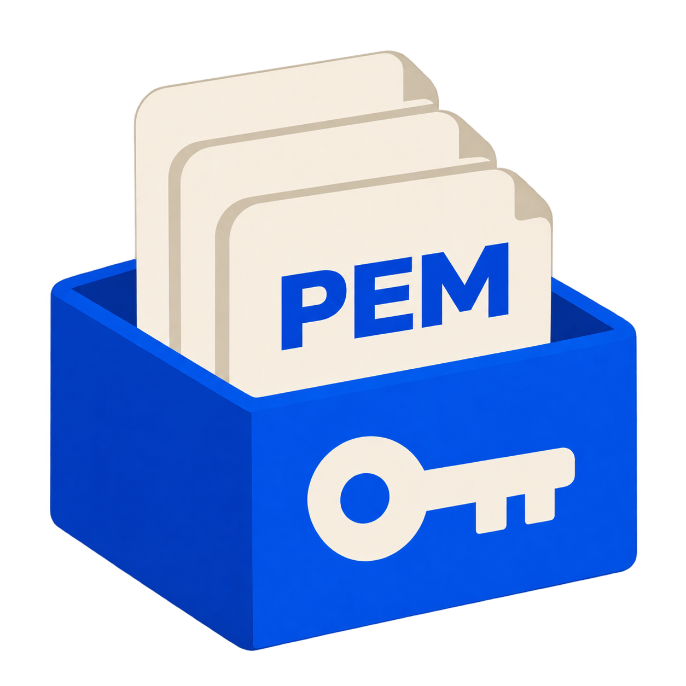

# CertBox



**Desenvolvido com IA.** O código, a interface e o ícone foram produzidos com
uso de IA durante o desenvolvimento. Bibliotecas externas mantêm sua autoria
e suas licenças. O programa não utiliza serviços de IA durante o processamento
dos seus arquivos.

[English](docs/README.en.md) · [Español](docs/README.es.md)

<!-- project-links:start -->
[Projeto](https://github.com/gabrielx8v/CertBox) · [Baixar executável](https://github.com/gabrielx8v/CertBox/releases) · [Código-fonte](https://github.com/gabrielx8v/CertBox) · [Suporte](https://github.com/gabrielx8v/CertBox/issues)
<!-- project-links:end -->

CertBox é um utilitário gráfico de software livre para inspecionar certificados
X.509 e exportar certificados e chaves privadas em CRT, PEM e KEY. Todo o
processamento acontece localmente, sem instalar certificados no sistema.

## Baixar e executar

Escolha o arquivo da release para seu sistema:

- Windows x64: certbox-windows-x64.exe, portátil, sem assinatura Authenticode.
- Linux x64: certbox-linux-x64.tar.gz. Extraia e abra CertBox/certbox no gerenciador de arquivos.

**A versão Linux não foi testada manualmente.** Consulte [requisitos e alcance dos testes](docs/LINUX.md).

Cada entrega inclui seu runtime .NET e somente o backend de sua plataforma.
No Windows, não é preciso instalar .NET ou OpenSSL. No Linux, são necessárias
as bibliotecas usuais do sistema, incluindo OpenSSL e X11/XWayland, conforme o guia.
O Windows pode mostrar um aviso de aplicativo desconhecido por falta de assinatura
ou reputação. Não há versões separadas de CLI ou shell/bash.

Confira a origem do download e compare o SHA-256 com SHA256SUMS.txt da mesma
release. O hash verifica correspondência entre arquivos, não garante ausência
de vulnerabilidades. Mantenha as proteções do Windows ativas.

```powershell
Get-FileHash -Algorithm SHA256 -LiteralPath .\certbox-windows-x64.exe
```

## Funcionalidades

- Importação por arraste ou seleção de arquivos, identificação pelo conteúdo,
  etiquetas por tipo e remoção individual.
- Visualização de titular, emissor, datas, chave pública, assinatura, DNS/SAN,
  número de série, SHA-256 e campos adicionais presentes no certificado.
- Seleção independente dos certificados que serão exportados; cada intermediária
  pode ser escolhida separadamente. As caixas começam desmarcadas.
- Exportar CRT: reúne somente os certificados marcados, sem chave privada.
- Gerar PEM: reúne os certificados marcados e inclui a chave carregada quando
  o certificado do domínio está marcado, após verificar o par.
- Salvar chave: exporta somente a chave e preserva a criptografia existente.
- Duas colunas ajustáveis, divisória deslizante, rolagem e português, inglês e espanhol.

## Formatos e limites

Certificados X.509 em PEM/DER, incluindo arquivos CRT/CER; chaves RSA, EC e DSA
nos formatos PKCS#8, RSA PKCS#1 e EC SEC1, conforme o algoritmo. PKCS#8
criptografado é preservado. Gerar PEM com uma chave protegida exige sua senha
para conferir o par; copiar essa chave separadamente não remove a proteção.

Limites: 32 arquivos de certificados, uma chave, 128 certificados e 16 MB por
arquivo. PFX/P12, PKCS#7, OpenSSH, Ed25519 e PEM com criptografia antiga Proc-Type
não são suportados. Um pacote PEM com chave deve ser carregado sozinho.

A indicação de prazo **não confirma confiança pública, revogação, correspondência
com um site ou validade completa para TLS**. A cadeia usa somente os certificados
fornecidos, sem baixar emissores. Veja [o alcance das verificações](docs/HELP.pt.md).

## Configurações e privacidade

Na primeira abertura, escolha o idioma sugerido pelo sistema. A engrenagem
permite mudá-lo depois, preservando arquivos e seleções. Somente o idioma é
gravado em %LOCALAPPDATA%\CertBox\settings.json no Windows; no Linux, em
$XDG_CONFIG_HOME/CertBox/settings.json ou ~/.config/CertBox/settings.json.
A preferência é por usuário e computador. Excluir esse arquivo restaura a escolha
inicial. O programa continua portátil.

Certificados, chaves e senhas não são enviados à internet nem gravados nas
preferências. Não há conta, anúncios, telemetria ou consulta automática de
atualizações. [Política de privacidade](docs/PRIVACY.pt.md).

## Software livre e suporte

GPLv3 ou posterior: [LICENSE](LICENSE) e [NOTICE.md](NOTICE.md). Distribuído sem
garantia, nos termos da licença. Os avisos originais de componentes externos
estão em [THIRD_PARTY_NOTICES.md](THIRD_PARTY_NOTICES.md), licenses/ e nas
configurações do programa. As fontes das dependências estão em
[DEPENDENCIES.md](DEPENDENCIES.md).

Use as issues do repositório para dúvidas e erros, informando versão do CertBox,
sistema operacional e passos de reprodução com certificados fictícios. Nunca publique chaves
privadas, senhas ou arquivos de clientes. Veja [SECURITY.md](SECURITY.md) para
relatos sensíveis e [CONTRIBUTING.md](CONTRIBUTING.md) para contribuir.

Para compilar: [BUILDING.md](BUILDING.md). Para preparar a release:
[RELEASE.md](RELEASE.md). Histórico: [CHANGELOG.md](CHANGELOG.md).
