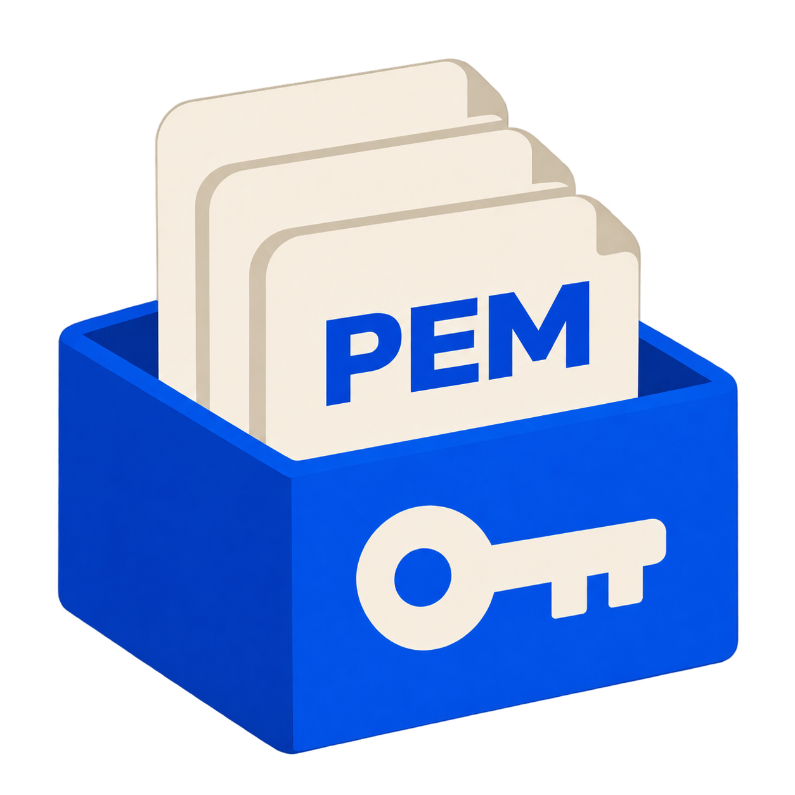

# CertBox



**Developed with AI.** The code, interface and icon were produced using AI
during development. External libraries retain their authorship and licenses.
The app does not use AI services while processing your files.

[Português](../README.md) · [Español](README.es.md)

<!-- project-links:start -->
[Project](https://github.com/gabrielx8v/CertBox) · [Download executable](https://github.com/gabrielx8v/CertBox/releases) · [Source](https://github.com/gabrielx8v/CertBox) · [Support](https://github.com/gabrielx8v/CertBox/issues)
<!-- project-links:end -->

CertBox is a free software desktop utility for inspecting X.509 certificates
and exporting certificates and private keys as CRT, PEM and KEY files.
Processing is local, and certificates are not installed in the system.

## Download and run

Choose the release file for your system:

- Windows x64: certbox-windows-x64.exe, portable and not Authenticode-signed.
- Linux x64: certbox-linux-x64.tar.gz. Extract and open CertBox/certbox in your file manager.

**The Linux version has not been manually tested.** See [Linux requirements and test scope](LINUX.md).

Each build includes .NET and only its platform backend. Windows needs no separate
.NET or OpenSSL installation. Linux requires the usual system libraries, including
OpenSSL and X11/XWayland. There are no separate CLI or shell launcher versions.
Windows may warn that the app is unknown because of its signature or reputation.

Verify the download's source and compare its SHA-256 with SHA256SUMS.txt from
the same release. A hash verifies file correspondence, not the absence of
vulnerabilities. Keep Windows security protections enabled.

```powershell
Get-FileHash -Algorithm SHA256 -LiteralPath .\certbox-windows-x64.exe
```

## Features

- Drag-and-drop or file picker import, content-based identification, role labels
  and individual file removal.
- Subject, issuer, dates, public key, signature, DNS/SAN, serial number, SHA-256
  and additional certificate fields.
- Independent export selection; choose each intermediate certificate separately.
  All checkboxes start unchecked.
- Export CRT groups checked certificates without a private key.
- Create PEM includes the loaded key when the domain certificate is checked,
  after verifying the pair. Save key exports only the key and preserves encryption.
- Resizable columns and file section, scrolling, Portuguese, English and Spanish.

## Formats and scope

PEM/DER X.509 certificates, including CRT/CER; RSA, EC and DSA keys in PKCS#8,
RSA PKCS#1 and EC SEC1 as appropriate. Encrypted PKCS#8 is preserved. Creating
a PEM with a protected key requires its password to verify the pair; copying
the key separately preserves protection.

Limits: 32 certificate files, one key, 128 certificates and 16 MB per file.
PFX/P12, PKCS#7, OpenSSH, Ed25519 and legacy Proc-Type encryption are unsupported.
A PEM bundle containing a key must be loaded on its own.

The validity-period indicator does not establish public trust, revocation
status, website matching or full TLS validity. Only supplied certificates are
used for chain ordering; issuers are not downloaded. See [scope](HELP.en.md).

## Settings, privacy and license

Choose a language on first launch; change it later through the gear without
losing loaded files or export selections. Only the language is persisted in
%LOCALAPPDATA%\CertBox\settings.json on Windows, or
$XDG_CONFIG_HOME/CertBox/settings.json (falling back to ~/.config/CertBox/settings.json)
on Linux, for each user and computer. Deleting it restores the initial choice.
The executable remains portable.

No files, private keys or passwords are sent to the internet or saved in
preferences. No account, advertising, telemetry or automatic update checks.
See [privacy](PRIVACY.en.md).

GPL version 3 or later: [LICENSE](../LICENSE) and [NOTICE](../NOTICE.md), without
warranty under the license terms. Original third-party notices are included in
the app and in [THIRD_PARTY_NOTICES.md](../THIRD_PARTY_NOTICES.md) and licenses/.
See [dependency sources](../DEPENDENCIES.md).

Report problems through repository issues with the app version, operating system
or Linux distribution and synthetic examples. Never share real private keys, passwords or customer
files. See [security](../SECURITY.md), [contributing](../CONTRIBUTING.md),
[building](../BUILDING.md), [release preparation](../RELEASE.md) and
[changelog](../CHANGELOG.md).
