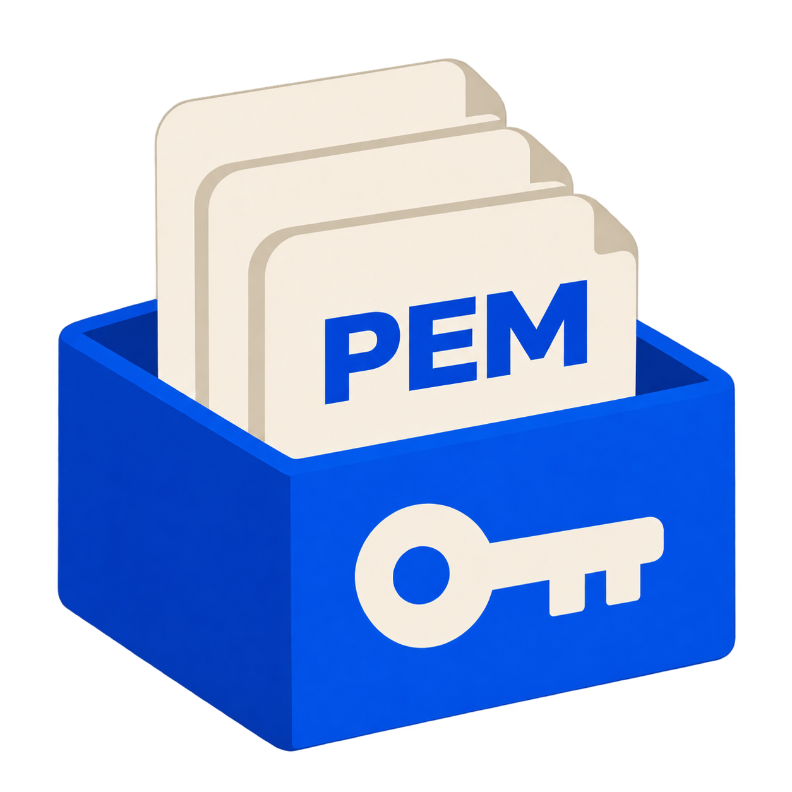

# CertBox



**Desarrollado con IA.** El código, la interfaz y el icono se produjeron con
uso de IA durante el desarrollo. Las bibliotecas externas conservan su autoría
y sus licencias. La aplicación no utiliza servicios de IA al procesar tus archivos.

[Português](../README.md) · [English](README.en.md)

<!-- project-links:start -->
[Proyecto](https://github.com/gabrielx8v/CertBox) · [Descargar ejecutable](https://github.com/gabrielx8v/CertBox/releases) · [Código fuente](https://github.com/gabrielx8v/CertBox) · [Soporte](https://github.com/gabrielx8v/CertBox/issues)
<!-- project-links:end -->

CertBox es una utilidad gráfica de software libre para inspeccionar certificados
X.509 y exportar certificados y claves privadas en CRT, PEM y KEY. El procesamiento
es local y los certificados no se instalan en el sistema.

## Descargar y ejecutar

Elige el archivo de la versión para tu sistema:

- Windows x64: certbox-windows-x64.exe, portátil y sin firma Authenticode.
- Linux x64: certbox-linux-x64.tar.gz. Extrae el archivo y abre CertBox/certbox desde el gestor de archivos.

**La versión Linux no ha sido probada manualmente.** Consulta [requisitos y alcance de las pruebas](LINUX.md).

Cada compilación incluye .NET y solo el backend de su plataforma. Windows no
requiere instalar .NET ni OpenSSL por separado. Linux requiere las bibliotecas
habituales del sistema, incluidos OpenSSL y X11/XWayland. No hay versiones CLI
ni iniciadores shell separados. Windows puede mostrar un aviso de aplicación
desconocida por su estado de firma o reputación.

Comprueba el origen y compara el SHA-256 con SHA256SUMS.txt de la misma versión.
El hash comprueba la correspondencia entre archivos, no la ausencia de
vulnerabilidades. Mantén activas las protecciones de Windows.

```powershell
Get-FileHash -Algorithm SHA256 -LiteralPath .\certbox-windows-x64.exe
```

## Funciones

- Importación por arrastre o selector, identificación por contenido, etiquetas
  de tipo y eliminación individual de archivos.
- Titular, emisor, fechas, clave pública, firma, DNS/SAN, número de serie, SHA-256
  y campos adicionales presentes en el certificado.
- Selección independiente para exportar cada certificado y cada CA intermedia.
  Todas las casillas comienzan sin marcar.
- Exportar CRT agrupa los certificados marcados sin clave privada.
- Crear PEM incluye la clave cargada si el certificado del dominio está marcado,
  tras comprobar el par. Guardar clave exporta solo la clave y conserva el cifrado.
- Columnas y sección de archivos ajustables, desplazamiento y tres idiomas.

## Formatos y alcance

Certificados X.509 PEM/DER, incluidos CRT/CER, y claves RSA, EC y DSA en PKCS#8,
RSA PKCS#1 y EC SEC1, según corresponda. Se conserva PKCS#8 cifrado. Crear un
PEM con una clave protegida requiere su contraseña para comprobar el par;
copiar la clave por separado conserva su protección.

Límites: 32 archivos de certificados, una clave, 128 certificados y 16 MB por
archivo. No se admiten PFX/P12, PKCS#7, OpenSSH, Ed25519 ni cifrado antiguo
Proc-Type. Un paquete PEM con clave debe cargarse solo.

El indicador de plazo no confirma confianza pública, revocación, correspondencia
con un sitio web ni validez completa para TLS. La cadena usa solo los certificados
proporcionados, sin descargar emisores. Consulta [el alcance](HELP.es.md).

## Configuración, privacidad y licencia

Elige el idioma al iniciar por primera vez y cámbialo desde el engranaje sin
perder archivos ni selecciones. Solo se guarda el idioma en
%LOCALAPPDATA%\CertBox\settings.json en Windows, o
$XDG_CONFIG_HOME/CertBox/settings.json (con alternativa ~/.config/CertBox/settings.json)
en Linux, por usuario y equipo. Eliminar ese archivo restablece la elección inicial.
El ejecutable sigue siendo portátil.

No se envían archivos, claves ni contraseñas a internet ni se guardan en las
preferencias. Sin cuenta, anuncios, telemetría ni consultas automáticas de
actualizaciones. Consulta [privacidad](PRIVACY.es.md).

GPL versión 3 o posterior: [LICENSE](../LICENSE) y [NOTICE](../NOTICE.md), sin
garantía según los términos de la licencia. Los avisos de terceros están
incluidos en la aplicación, [THIRD_PARTY_NOTICES.md](../THIRD_PARTY_NOTICES.md)
y licenses/. Consulta [las fuentes de dependencias](../DEPENDENCIES.md).

Informa de problemas mediante las issues del repositorio con la versión de la
aplicación, el sistema operativo y ejemplos ficticios. Nunca compartas claves privadas,
contraseñas ni archivos de clientes. Consulta [seguridad](../SECURITY.md),
[contribuciones](../CONTRIBUTING.md), [compilación](../BUILDING.md),
[publicación](../RELEASE.md) e [historial](../CHANGELOG.md).
